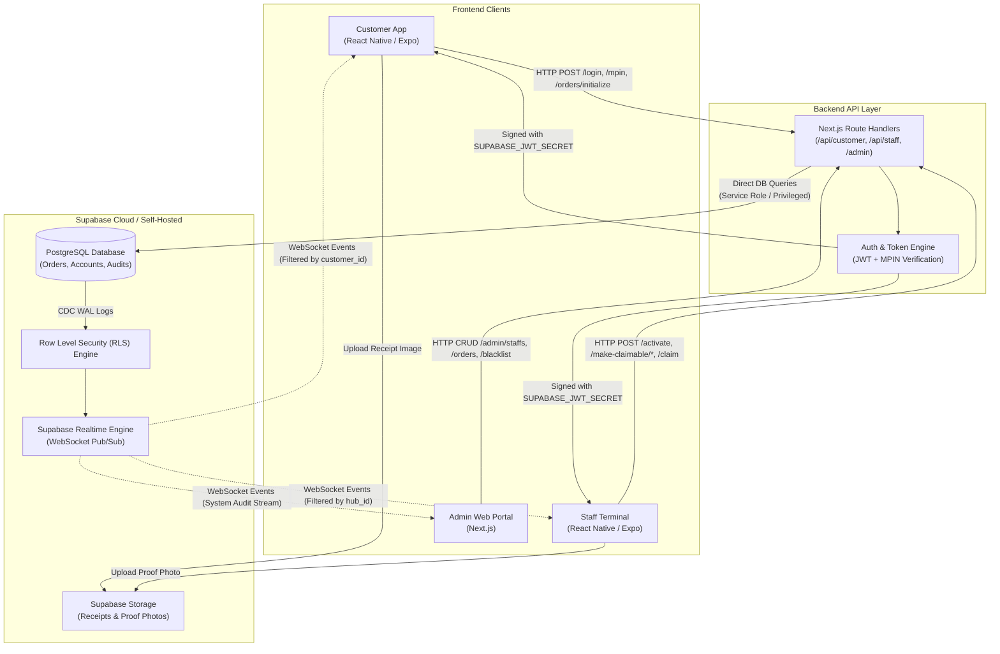

# ParcelHub System Architecture & Specification

## 1. System Overview

ParcelHub operates on a decoupled, real-time distributed architecture designed for low-latency parcel tracking, counter handoffs, and hub logistics.

### Component Breakdown
1. **Customer Mobile App (React Native / Expo)**: End-user app for order creation, cash deposit tracking, claim initiation, and pickup QR display.
2. **Staff Terminal App (React Native / Expo)**: Physical counter terminal for cash reception, courier payout verification, proof-of-delivery photo capture, and customer parcel release.
3. **Admin Web Portal (Next.js / React)**: Desktop web interface for staff management, audit log inspection, customer moderation (blacklisting), and OCR feature toggles.
4. **Backend API & Orchestration (Next.js App Router)**: Server-authoritative route handlers (`/api/customer/*`, `/api/staff/*`, `/admin/*`) that enforce order state machines, business validation rules, and JWT issuance.
5. **Database & Realtime PubSub (Supabase PostgreSQL)**: Core database with Row Level Security (RLS), Postgres Change Data Capture (CDC), and direct WebSocket PubSub channels for cross-device state synchronization.
6. **Object Storage (Supabase Storage)**: Secure buckets for parcel receipt uploads and staff proof-of-delivery photos.

---

## 2. High-Level Architecture Diagram



---

## 3. Data Flow & Communication Patterns

### A. Mutations & State Changes (Server-Authoritative)
All state-modifying actions **must go through the Next.js API Routes** rather than direct client-to-database writes:
- Validating cash inputs (`amountReceived >= codAmount`).
- Calculating cash change.
- Enforcing sequence guards (e.g. proof photos cannot be attached before courier payout is logged).
- Starting and verifying handoff expiry countdowns.

### B. Real-Time Event Sync (Direct WebSocket PubSub via RLS)
Once the Next.js backend commits an order update to PostgreSQL, the database triggers a Postgres CDC event. Clients listening on WebSockets receive live updates without polling:
1. **Customer clicks "Initiate Claim"** on phone $\rightarrow$ `POST /api/customer/orders/{id}/claim` $\rightarrow$ Next.js marks `claim_initiated_at = NOW()`.
2. **Postgres commits** $\rightarrow$ Supabase Realtime pushes event to the counter staff tablet.
3. **Staff Tablet unlocks** the "Release Parcel" button instantly.

---

## 4. Authentication & Security (RLS Architecture)

### Token Issuance & Supabase Compatibility
To allow React Native clients to subscribe directly to Supabase WebSockets while respecting Row Level Security, tokens are signed using the **Supabase JWT Secret**:
1. Customer/Staff logs in via Next.js `/api/{role}/login` and verifies MPIN via `/api/customer/mpin`.
2. Next.js creates a JWT with:
   ```json
   {
     "sub": "user_uuid",
     "role": "authenticated",
     "user_role": "customer", // or "staff" / "admin"
     "hub_id": "hub_cebu_yati", // for staff
     "exp": 1793520000
   }
   ```
3. The client initializes the Supabase client using this `authToken`:
   ```typescript
   supabase.realtime.setAuth(authToken);
   ```

### Row Level Security (RLS) Policies

```sql
-- Enable RLS on Orders
ALTER TABLE orders ENABLE ROW LEVEL SECURITY;

-- 1. Customers can ONLY read their own orders
CREATE POLICY customer_order_select_policy ON orders
  FOR SELECT
  TO authenticated
  USING (customer_id = auth.uid());

-- 2. Staff can read all orders assigned to their physical Hub
CREATE POLICY staff_hub_order_select_policy ON orders
  FOR SELECT
  TO authenticated
  USING (
    (auth.jwt() ->> 'user_role' = 'staff') AND
    (hub_id = (auth.jwt() ->> 'hub_id'))
  );

-- 3. Admins have complete read access for auditing
CREATE POLICY admin_order_audit_policy ON orders
  FOR SELECT
  TO authenticated
  USING (auth.jwt() ->> 'user_role' = 'admin');
```

---

## 5. Subsystem Responsibilities

| Subsystem | Technology | Primary Responsibilities |
| :--- | :--- | :--- |
| **Customer App** | React Native / Expo | Order initialization, receipt image capture, payment breakdown review, QR code display, pickup claim trigger. |
| **Staff App** | React Native / Expo | Cash reception & change calculation, courier payout logging, counter parcel verification, proof photo capture, final release. |
| **Admin Web** | Next.js App Router | Staff provisioning, full versioned audit trail inspection, user moderation / blacklisting, OCR feature flag toggling. |
| **Backend API** | Next.js API Routes | Strict route contract validation, business rule execution, token issuing, privileged transactions. |
| **Database** | Supabase Postgres | Master ACID storage, audit logging, RLS enforcement, foreign key constraints. |
| **Realtime Engine** | Supabase Realtime | WebSocket connection termination, room pub/sub, live table broadcast. |
| **File Storage** | Supabase Storage | S3-compatible image hosting for receipts and delivery proof photos. |

---

## 6. Directory Structure Blueprint

```
Parcelhub/
├── apps/
│   ├── customer-mobile/       # React Native / Expo (Customer Client)
│   │   ├── src/screens/
│   │   ├── src/services/api.ts
│   │   └── src/services/realtime.ts
│   ├── staff-mobile/          # React Native / Expo (Counter Staff Client)
│   │   ├── src/screens/
│   │   └── src/services/
│   └── admin-web/             # Next.js Admin Management Portal
│       └── app/admin/
├── backend/                   # Next.js API Server
│   ├── app/api/
│   │   ├── customer/          # /api/customer/*
│   │   ├── staff/             # /api/staff/*
│   │   ├── admin/             # /admin/*
│   │   └── notification/      # /api/notification/*
│   └── lib/
│       ├── supabaseAdmin.ts   # Service role DB client
│       └── stateMachine.ts    # Reusable order state logic
└── supabase/
    ├── migrations/            # SQL schemas, triggers & RLS rules
    └── seed.sql               # Initial hub and test fixture data
```

---

## 7. Development & Deployment Roadmap

1. **Phase 1: Database & RLS Schema**:
   - Apply PostgreSQL schemas for `users`, `orders`, `order_audits`, and `staff_profiles`.
   - Configure RLS policies for `customer`, `staff`, and `admin` roles.
2. **Phase 2: Next.js API Routes**:
   - Port business rules from [`orderApi.ts`](file:///c:/Users/JV/Desktop/Parcelhub-spade/Parcelhub/mobile-web-prototype/src/services/orderApi.ts) and [`customerApi.ts`](file:///c:/Users/JV/Desktop/Parcelhub-spade/Parcelhub/mobile-web-prototype/src/services/customerApi.ts) into Next.js App Router endpoints.
   - Implement Supabase-compatible JWT generation upon MPIN verification.
3. **Phase 3: Client Porting**:
   - Convert `mobile-web-prototype` views into React Native primitives (`View`, `Text`, `Pressable`, NativeWind).
   - Split views into customer screens (`apps/customer-mobile`) and staff terminal (`apps/staff-mobile`).
   - Subscribe clients to `supabase.channel('orders')` with RLS filters.
4. **Phase 4: Admin Web Portal & Push Notifications**:
   - Build Next.js audit tables and staff management views.
   - Connect FCM push notifications via `/api/notification/*`.

