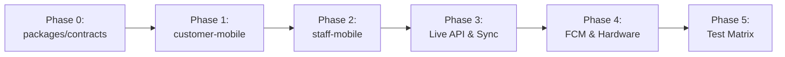

# ParcelHub React Native Expo Migration Checklist

> **Authoritative Migration Specification & Execution Runbook**  
> **Source Spec**: [`mobile-web-prototype`](file:///c:/Users/JV/Desktop/Parcelhub-spade/Parcelhub/mobile-web-prototype), [`temp/staff-ui/`](file:///c:/Users/JV/Desktop/Parcelhub-spade/Parcelhub/temp/staff-ui), [`API_ROUTES_README.md`](file:///c:/Users/JV/Desktop/Parcelhub-spade/Parcelhub/API_ROUTES_README.md), [`ARCHITECTURE_README.md`](file:///c:/Users/JV/Desktop/Parcelhub-spade/Parcelhub/ARCHITECTURE_README.md), and [`.agents/skills/expo-fcm/SKILL.md`](file:///c:/Users/JV/Desktop/Parcelhub-spade/Parcelhub/.agents/skills/expo-fcm/SKILL.md).

---

## 📋 Table of Contents
1. [Architectural Overview & Core Decisions](#1-architectural-overview--core-decisions)
2. [Target Monorepo Workspace Topology](#2-target-monorepo-workspace-topology)
3. [Phase 0: Workspace Scaffolding & `@parcelhub/contracts`](#phase-0-workspace-scaffolding--packagescontracts)
4. [Phase 1: Customer Mobile App (`apps/customer-mobile`)](#phase-1-customer-mobile-app-appscustomer-mobile)
5. [Phase 2: Staff Mobile Terminal (`apps/staff-mobile`)](#phase-2-staff-mobile-terminal-appsstaff-mobile)
6. [Phase 3: Live API Integration & Realtime PubSub](#phase-3-live-api-integration--realtime-pubsub)
7. [Phase 4: Native Hardware, FCM Push & EAS Build Readiness](#phase-4-native-hardware-fcm-push--eas-build-readiness)
8. [Phase 5: Automated Testing & Invariants Verification Matrix](#phase-5-automated-testing--invariants-verification-matrix)
9. [Phase 6: Step-by-Step Agent Execution Runbook](#phase-6-step-by-step-agent-execution-runbook)

---

## 1. Architectural Overview & Core Decisions

### Core Tenets
- **Separate Apps**: Dedicated Expo applications for Customer (`apps/customer-mobile`) and Staff (`apps/staff-mobile`) to isolate permissions, dependencies, and bundle size.
- **Shared Domain Contracts**: Common TypeScript models, DTOs, API route contracts, and state helpers reside strictly in `packages/contracts`.
- **Navigation**: Expo Router (v4+ file-based routing) inside `app/` directories with typed routes.
- **Styling**: NativeWind v4 (Tailwind CSS engine) adhering to the ParcelHub Design System tokens (Primary Blue `#215cd4`, Slate `#647b92`, Emerald `#10b780`, Warning Gold `#c58b12`, Muted Surface `#f8f8f8`, Terminal Dark `#0f172a`) and responsive tablet/mobile viewports matching `temp/staff-ui/` and `mobile-web-prototype`.
- **Hardware Integrations**:
  - Scanning: `expo-camera` with animated viewfinder reticle and barcode scanner.
  - Token Security: `expo-secure-store` for hardware-backed JWT and MPIN session token persistence.
  - Push Notifications: `@react-native-firebase/app` + `@react-native-firebase/messaging` using the **Modular API (v22+/v27+)** and ProGuard keep rules per `.agents/skills/expo-fcm/SKILL.md`.
- **Strict Backend Alignment**: 100% adherence to `API_ROUTES_README.md` and `ARCHITECTURE_README.md` with zero mock divergence in production.

---

## 2. Target Monorepo Workspace Topology

```
Parcelhub/
├── package.json                   # Root monorepo workspace configuration (npm/pnpm/yarn)
├── pnpm-workspace.yaml            # Monorepo packages manifest (if using pnpm)
├── tsconfig.base.json             # Root TypeScript compiler options & path aliases
├── API_ROUTES_README.md           # Authoritative REST API route specifications
├── ARCHITECTURE_README.md         # Authoritative System & RLS Architecture
├── MIGRATION_CHECKLIST.md         # This authoritative checklist document
├── .agents/skills/expo-fcm/       # FCM Setup and verification skill
│
├── packages/
│   └── contracts/                 # Shared TypeScript domain contracts & utilities
│       ├── package.json
│       ├── tsconfig.json
│       └── src/
│           ├── index.ts           # Barrel export
│           ├── types/             # Domain models (Order, OrderStatus, DraftOrder, etc.)
│           ├── api/               # API route request/response DTOs & status types
│           ├── state/             # Order state machine & transition rules
│           └── utils/             # Currency parser, stated fee calculator, countdown helpers
│
├── apps/
│   ├── customer-mobile/           # Expo React Native App for Customers
│   │   ├── package.json
│   │   ├── app.json               # Expo config + Firebase plugins + ProGuard rules
│   │   ├── eas.json               # EAS build profiles (preview APK & production)
│   │   ├── google-services.json   # Android FCM credentials
│   │   ├── tailwind.config.js     # NativeWind v4 design tokens
│   │   ├── global.css             # Tailwind directives & CSS variable tokens
│   │   ├── metro.config.js        # NativeWind + Monorepo resolver
│   │   ├── index.js               # Background FCM message handler entry point
│   │   └── app/                   # Expo Router File-Based Navigation
│   │       ├── _layout.tsx        # App root provider & Auth gatekeeper
│   │       ├── (auth)/            # Auth stack (Login, Register, MPIN)
│   │       │   ├── login.tsx
│   │       │   ├── register.tsx
│   │       │   ├── mpin-create.tsx
│   │       │   └── mpin-login.tsx
│   │       ├── (tabs)/            # Main customer navigation tabs
│   │       │   ├── _layout.tsx
│   │       │   ├── index.tsx      # Home screen (Active orders, zero state)
│   │       │   └── transactions.tsx # History & filtered orders list
│   │       └── orders/            # Order creation & tracking screens
│   │           ├── create.tsx     # Order creation & receipt upload
│   │           ├── confirm.tsx    # Order review & fee breakdown
│   │           ├── payment-verification.tsx # Cash deposit waiting screen
│   │           ├── [id].tsx       # Live tracking & claim initiation
│   │           └── [id]/qr.tsx    # Pickup QR Pass display
│   │
│   └── staff-mobile/              # Expo React Native App for Hub Counter Staff
│       ├── package.json
│       ├── app.json               # Expo config + Camera/FCM plugins + ProGuard rules
│       ├── eas.json               # EAS build profiles
│       ├── google-services.json   # Android FCM credentials
│       ├── tailwind.config.js     # NativeWind v4 design tokens
│       ├── global.css             # Tailwind directives
│       ├── metro.config.js        # NativeWind + Monorepo resolver
│       ├── index.js               # Background FCM message handler entry point
│       └── app/                   # Expo Router File-Based Navigation
│           ├── _layout.tsx        # Staff root provider & authentication gate
│           ├── (auth)/
│           │   └── login.tsx      # Staff counter login screen
│           ├── (terminal)/        # Counter operations tabs & scanner
│           │   ├── _layout.tsx
│           │   ├── index.tsx      # Counter desk orders queue (Active/Ready/Unpaid/Claimed)
│           │   ├── scanner.tsx    # Camera barcode/QR scanner modal/screen
│           │   └── activity.tsx   # Completed audit log
│           └── orders/
│               └── [id].tsx       # Staff order action modal (Activate, Pay, Attach, Release)
│
└── mobile-web-prototype/          # Reference web prototype (Retain for automated parity tests)
```

---

## Phase 0: Workspace Scaffolding & `packages/contracts`

- [ ] **0.1. Initialize Monorepo Root Configuration**
  - [ ] Create root `package.json` with workspace settings:
    ```json
    {
      "name": "parcelhub-monorepo",
      "private": true,
      "workspaces": [
        "packages/*",
        "apps/*"
      ]
    }
    ```
  - [ ] Create `tsconfig.base.json` with strict type checking and workspace path mappings (`@parcelhub/contracts`).
  - [ ] Configure `.gitignore` to ignore `node_modules`, `.expo`, `dist/`, `android/`, `ios/`, and sensitive keystores.

- [ ] **0.2. Scaffold `packages/contracts`**
  - [ ] Create `packages/contracts/package.json` (name: `@parcelhub/contracts`, version: `1.0.0`, `main: ./src/index.ts`).
  - [ ] Port types from [`mobile-web-prototype/src/types/index.ts`](file:///c:/Users/JV/Desktop/Parcelhub-spade/Parcelhub/mobile-web-prototype/src/types/index.ts):
    - [ ] `OrderStatus`: `'PAYMENT_REQUIRED' | 'AWAITING_PARCEL' | 'READY_TO_CLAIM' | 'CLAIMED'`.
    - [ ] `Order` interface (id, trackingNumber, refCode, alphanumericKey, paidAmount, codAmount, change, status, timestamps, notes, statedFee).
    - [ ] `DraftOrder` interface for customer order initialization.
    - [ ] Authentication request & response interfaces:
      - `CustomerRegisterRequest`, `CustomerRegisterResponse`
      - `CustomerLoginRequest`, `CustomerLoginResponse`
      - `CustomerCreateMpinRequest`, `CustomerCreateMpinResponse`
      - `CustomerVerifyMpinRequest`, `CustomerVerifyMpinResponse`
      - `StaffLoginRequest`, `StaffLoginResponse`
    - [ ] Notification interfaces (`NotificationItem`, `FCMTokenPayload`).
  - [ ] Port business calculations and status helpers from [`mobile-web-prototype/src/services/orderApi.ts`](file:///c:/Users/JV/Desktop/Parcelhub-spade/Parcelhub/mobile-web-prototype/src/services/orderApi.ts) and [`mobile-web-prototype/src/utils/statusHelpers.ts`](file:///c:/Users/JV/Desktop/Parcelhub-spade/Parcelhub/mobile-web-prototype/src/utils/statusHelpers.ts):
    - [ ] `parseCurrency(str?: string | null): number`
    - [ ] `getStatedFee(order: Order): number`
    - [ ] `isClaimUnlocked(order: Order, cutoffMins?: number): boolean`
    - [ ] `getClaimTimeRemainingSeconds(order: Order, cutoffMins?: number): number`
    - [ ] `getStatusBadgeVariant(status: OrderStatus)` and badge label mappings.
  - [ ] Add unit tests in `packages/contracts/test` to verify 100% calculation parity.
  - [ ] Run test verification: `npm --prefix packages/contracts test`.

---

## Phase 1: Customer Mobile App (`apps/customer-mobile`)

- [ ] **1.1. Project Initialization & NativeWind v4 Setup**
  - [ ] Initialize Expo SDK 52+ app in `apps/customer-mobile` with Expo Router:
    ```bash
    npx create-expo-app@latest apps/customer-mobile --template blank-typescript
    ```
  - [ ] Install core Expo & UI packages:
    ```bash
    npx expo install expo-router expo-secure-store expo-image expo-camera react-native-safe-area-context react-native-screens expo-status-bar
    npm install nativewind tailwindcss react-native-reanimated react-native-svg
    ```
  - [ ] Configure `metro.config.js` with `withNativeWind` and monorepo workspace resolution:
    ```javascript
    const { getDefaultConfig } = require('expo/metro-config');
    const { withNativeWind } = require('nativewind/metro');
    const path = require('path');

    const projectRoot = __dirname;
    const monorepoRoot = path.resolve(projectRoot, '../..');
    const config = getDefaultConfig(projectRoot);

    config.watchFolders = [monorepoRoot];
    config.resolver.nodeModulesPaths = [
      path.resolve(projectRoot, 'node_modules'),
      path.resolve(monorepoRoot, 'node_modules'),
    ];

    module.exports = withNativeWind(config, { input: './global.css' });
    ```
  - [ ] Configure `tailwind.config.js` with ParcelHub brand color and typography tokens:
    ```javascript
    /** @type {import('tailwindcss').Config} */
    module.exports = {
      content: [
        "./app/**/*.{js,jsx,ts,tsx}",
        "./components/**/*.{js,jsx,ts,tsx}",
        "../../packages/contracts/src/**/*.{js,jsx,ts,tsx}"
      ],
      presets: [require("nativewind/preset")],
      theme: {
        extend: {
          colors: {
            brand: {
              blue: "#215cd4",
              "blue-hover": "#194cb5",
              navy: "#163b86",
              dark: "#1e1e1e",
              emerald: "#10b780",
              gold: "#c58b12",
              "pill-green": "#93eb99",
              surface: "#f8f8f8",
              danger: "#ef4444",
              slate: "#647b92",
            },
          },
          fontFamily: {
            sans: ["PlusJakartaSans", "System"],
            mono: ["JetBrainsMono", "monospace"],
          },
        },
      },
      plugins: [],
    };
    ```

- [ ] **1.2. Storage & Auth Session Provider (`expo-secure-store`)**
  - [ ] Create `services/storage.ts`:
    - `saveRefreshToken(token: string)`: Secure store persistent save.
    - `getRefreshToken()`: Secure store fetch.
    - `saveAuthToken(token: string)`: Secure store persistent save.
    - `getAuthToken()`: Secure store fetch.
    - `clearSession()`: Clear all stored keys.
  - [ ] Create `context/CustomerAuthContext.tsx`:
    - Manages state: `user`, `authToken`, `refreshToken`, `isAuthenticated`, `isMpinLocked`.
    - Handles token hydration on app mount from `expo-secure-store`.
    - Provides auth dispatchers: `register()`, `login()`, `createMpin()`, `verifyMpin()`, `logout()`.

- [ ] **1.3. Screen Implementation: Customer Auth Stack**
  - [ ] **`app/(auth)/register.tsx`**:
    - Minimal 2-step registration layout (Name, Mobile, Email, Password).
    - Strict validation matching `RegisterScreen.tsx`.
    - Calls `POST /api/customer/register`, stores `refreshToken`, redirects to MPIN setup.
  - [ ] **`app/(auth)/login.tsx`**:
    - Email & Password login form.
    - Calls `POST /api/customer/login`, stores `refreshToken`, redirects to `mpin-login`.
  - [ ] **`app/(auth)/mpin-create.tsx`**:
    - Step 1: "Enter 4-digit MPIN" with custom numeric keypad (1-9, 0, Backspace).
    - Step 2: "Confirm your MPIN" with immediate mismatch detection.
    - Mismatch recovery: Immediate digit overwrite without keypad freeze.
    - Auto-submits on 4th digit; calls `POST /api/customer/create-mpin`.
  - [ ] **`app/(auth)/mpin-login.tsx`**:
    - Quick biometric/MPIN unlock screen for returning users.
    - 4 numeric dot indicators with auto-submit timer.
    - Backspace cancels auto-submit timer immediately.
    - Calls `POST /api/customer/mpin`, stores `authToken`, navigates to `(tabs)`.

- [ ] **1.4. Screen Implementation: Tabs & Customer Orders Stack**
  - [ ] **`app/(tabs)/index.tsx` (Home Screen)**:
    - Active order tracking card with dynamic status badge (`PAYMENT_REQUIRED`, `AWAITING_PARCEL`, `READY_TO_CLAIM`).
    - Quick actions: "Create Order", "View Pickup Pass", "Transactions".
    - Zero active orders empty state with clean call-to-action artwork.
  - [ ] **`app/(tabs)/transactions.tsx`**:
    - Tab filter bar: `ALL`, `READY_TO_CLAIM`, `AWAITING_PARCEL`, `PAYMENT_REQUIRED`, `CLAIMED`.
    - Virtualized `FlatList` with pull-to-refresh and empty filter state.
  - [ ] **`app/orders/create.tsx`**:
    - Receipt upload / photo selection form (Product name, recipient, declared amount).
    - Shopee/Lazada receipt parser simulation button.
    - "Continue to Review" navigates to confirm screen.
  - [ ] **`app/orders/confirm.tsx`**:
    - Summary breakdown: Item name, declared COD amount, stated fee, hub pickup address.
    - "Confirm Order" calls `POST /api/customer/orders/initialize`.
  - [ ] **`app/orders/payment-verification.tsx`**:
    - Awaiting cash deposit screen (status: `PAYMENT_REQUIRED`).
    - Explicit verification: No countdown hold timer; prompts customer to visit hub counter.
  - [ ] **`app/orders/[id].tsx` (Live Order Details & Tracking)**:
    - Real-time status timeline (Order Placed $\rightarrow$ Cash Paid $\rightarrow$ Arrived $\rightarrow$ Claimed).
    - Ready-to-claim action section:
      - Confirmation checkbox: "I am currently at the hub counter".
      - "Initiate Claim" button enabled only when checkbox is checked.
      - Calls `POST /api/customer/orders/{id}/claim`.
      - Starts live 5-minute countdown display (`getClaimTimeRemainingSeconds`).
      - Informs user: "Counter staff unlocked for pickup. Please present your QR pass."
  - [ ] **`app/orders/[id]/qr.tsx` (Pickup QR Pass)**:
    - High-contrast QR code display (using `react-native-qrcode-svg` or canvas).
    - Order Reference Code (`0001-XXXX-XXXX`) and Alphanumeric Key (`PH-XXX-XXXX`).
    - "Save Pass to Gallery" action affordance.

---

## Phase 2: Staff Mobile Terminal (`apps/staff-mobile`)

- [ ] **2.1. Project Initialization & Terminal Layout Setup**
  - [ ] Initialize Expo SDK 52+ app in `apps/staff-mobile` with Expo Router.
  - [ ] Install dependencies:
    ```bash
    npx expo install expo-router expo-secure-store expo-camera expo-image react-native-safe-area-context react-native-screens
    npm install nativewind tailwindcss react-native-reanimated react-native-svg
    ```
  - [ ] Configure responsive layout support:
    - 720px Tablet Console viewport (optimized for counter desk mount).
    - 412px Handheld Mobile viewport (for roaming warehouse staff).
  - [ ] Configure Dark Console / Figma theme matching [`temp/staff-ui/style.css`](file:///c:/Users/JV/Desktop/Parcelhub-spade/Parcelhub/temp/staff-ui/style.css), [`temp/suggested/staff-ui-figma-css.txt`](file:///c:/Users/JV/Desktop/Parcelhub-spade/Parcelhub/temp/suggested/staff-ui-figma-css.txt), and [`temp/suggested/staff-ui-qr-css.txt`](file:///c:/Users/JV/Desktop/Parcelhub-spade/Parcelhub/temp/suggested/staff-ui-qr-css.txt).
  - [ ] Configure `tailwind.config.js` for Staff Mobile with dark terminal tokens:
    - Slate Dark Background: `#0f172a` (slate-900)
    - Terminal Surface: `#1e293b` (slate-800)
    - Terminal Border: `#334155` (slate-700)
    - Header Slate: `#647b92`
    - Viewfinder Accent: `#2a51a3`
    - Font Family: `Plus Jakarta Sans` for UI labels, `JetBrains Mono` for order IDs and monetary values (`font-mono`).

- [ ] **2.2. Screen Implementation: Staff Terminal Core**
  - [ ] **`app/(auth)/login.tsx`**:
    - Staff authentication form (`email`, `password`).
    - Calls `POST /api/staff/login`, saves session credentials to `expo-secure-store`.
  - [ ] **`app/(terminal)/index.tsx` (Counter Desk Operations)**:
    - **Header**: Terminal Branding, Desk #01 indicator, Network online beacon.
    - **Search Bar**: Quick lookup for Tracking #, Alphanumeric Key, or Order ID (`ORD-XXX`).
    - **Docked Bottom Filter Tabs**:
      - 4 Status Tabs with explicit contract enum mappings (`StaffFilter` in `@parcelhub/contracts`):
        - `Active` tab: Filter key `'active'`, color `#215cd4` (Brand Blue), target status `AWAITING_PARCEL`.
        - `Ready` tab: Filter key `'ready_to_claim'`, color `#10b780` (Emerald), target status `READY_TO_CLAIM`.
        - `Unpaid` tab: Filter key `'inactive'`, color `#c58b12` (Warning Gold), target status `PAYMENT_REQUIRED`.
        - `Claimed` tab: Filter key `'claimed'`, color `#475569` (Slate Dark), target status `CLAIMED`.
      - Dynamic count badges per tab (`active`, `ready`, `unpaid`, `claimed`).
    - **Order Cards List**:
      - Card with recipient, carrier, tracking number, stated fee, and staff note preview.
      - Status-specific badges and quick action affordances.
      - Cross-tab suggestion chips when search match belongs to another tab.
    - **Scan QR FAB**:
      - Floating gradient action button docked above bottom navigation.
      - Launches camera scanner.

- [ ] **2.3. Screen Implementation: Hardware Barcode & QR Scanner (`app/(terminal)/scanner.tsx`)**
  - [ ] Integrate `expo-camera` (`CameraView` / `Camera` component):
    - Request camera permission (`useCameraPermissions`).
    - Center viewfinder with corner bracket reticles and animated scanning laser.
    - Real-time barcode / QR detection (`onBarcodeScanned`).
  - [ ] **Manual Order ID Lookup Component**:
    - Input formatted strictly as `XXX - XXX` with auto-hyphenation (e.g. typing `ORD408` automatically formats to `ORD - 408`).
    - Submits search on Enter or button click.
  - [ ] **Scan Resolution Workflow**:
    - When QR/barcode matches an order:
      - Automatically switch to that order's status tab.
      - Open the Order Details Action Modal immediately.
      - Play haptic feedback.

- [ ] **2.4. Screen Implementation: Staff Order Actions Modal (`app/orders/[id].tsx`)**
  - [ ] Implement the 4 distinct operational states:
    - **State A: Unpaid Order (`PAYMENT_REQUIRED`)**:
      - Numerical cash input for `Amount Received`.
      - Real-time validation: Requires `Amount Received >= Stated Fee`.
      - Live change preview: `Change = Amount Received - Stated COD`.
      - "Receive Cash & Activate" button disabled until valid.
      - Calls `POST /api/staff/orders/{id}/activate`.
      - On success: Advances order to `AWAITING_PARCEL`.
    - **State B: Active Order Courier Intake (`AWAITING_PARCEL`)**:
      - **Step 1**: "Pay Courier (₱COD)" button.
        - Calls `POST /api/staff/orders/{id}/make-claimable/pay`.
        - Logs rider payout. Guard: Cannot attach photo until payout is recorded.
      - **Step 2**: "Attach Parcel Photo" button.
        - Triggers camera capture or photo picker.
        - Calls `POST /api/staff/orders/{id}/make-claimable/attach-photo`.
        - On success: Advances order to `READY_TO_CLAIM`.
    - **State C: Ready to Claim Lock & Release (`READY_TO_CLAIM`)**:
      - Locked State: Displays `Locked (Awaiting Customer Prompt)`.
      - "Release Parcel" button is strictly disabled while locked.
      - Unlocked State: When customer initiates claim, displays live countdown timer and activates high-contrast "Release Parcel" CTA.
      - Calls `POST /api/staff/orders/{id}/claim`.
      - Advances order to `CLAIMED` and displays final cash change handover reminder.
    - **State D: Claimed Order Summary (`CLAIMED`)**:
      - Displays proof-of-delivery thumbnail, claimed timestamp, staff ID, and handover ledger.
  - [ ] **Staff Internal Notes & Ledger Drawer**:
    - View and update internal staff notes per order.
    - Financial ledger detailing: Customer Deposit, Courier Payout, Net Change Handed.

---

## Phase 3: Live API Integration & Realtime PubSub

- [ ] **3.1. Strict HTTP Client (`packages/contracts` or `services/api.ts`)**
  - [ ] Configure `axios` or native `fetch` client with interceptors:
    - Automatically injects `Authorization: Bearer <authToken>`.
    - Intercepts 401 Unauthorized responses to attempt token refresh via `refreshToken`.
    - Normalizes error payloads to typed domain errors.
  - [ ] Ensure full implementation of endpoints specified in `API_ROUTES_README.md`:
    - Customer:
      - `POST /api/customer/register`
      - `POST /api/customer/login`
      - `POST /api/customer/create-mpin`
      - `POST /api/customer/mpin`
      - `GET /api/customer/orders`
      - `GET /api/customer/orders/{id}`
      - `POST /api/customer/orders/initialize`
      - `PUT /api/customer/orders/{id}`
      - `DELETE /api/customer/orders/{id}`
      - `POST /api/customer/orders/{id}/claim`
    - Staff:
      - `POST /api/staff/login`
      - `GET /api/staff/orders`
      - `GET /api/staff/orders/{id}`
      - `POST /api/staff/orders/{id}/activate`
      - `POST /api/staff/orders/{id}/make-claimable/pay`
      - `POST /api/staff/orders/{id}/make-claimable/attach-photo`
      - `POST /api/staff/orders/{id}/claim`
    - Notifications:
      - `POST /api/notification/upload-token`
      - `POST /api/notification/send-notification`

- [ ] **3.2. Realtime WebSocket Synchronization (Supabase CDC)**
  - [ ] Configure `@supabase/supabase-js` realtime client in both mobile apps.
  - [ ] Supply Supabase JWT from auth session:
    ```typescript
    supabase.realtime.setAuth(authToken);
    ```
  - [ ] Subscribe Customer app to orders filtered by customer UUID (`customer_id = eq.<uid>`).
  - [ ] Subscribe Staff terminal to orders filtered by hub ID (`hub_id = eq.<hub_id>`).
  - [ ] Instant UI reactive updates:
    - When Customer initiates claim $\rightarrow$ Staff terminal unlocks "Release" button within < 300ms.
    - When Staff verifies courier photo $\rightarrow$ Customer phone updates to "Ready to Claim".
    - When Staff releases parcel $\rightarrow$ Customer phone transitions to "Claimed" with confetti.

---

## Phase 4: Native Hardware, FCM Push & EAS Build Readiness

> Follow all instructions and rules in [`.agents/skills/expo-fcm/SKILL.md`](file:///c:/Users/JV/Desktop/Parcelhub-spade/Parcelhub/.agents/skills/expo-fcm/SKILL.md) to prevent native crashes.

- [ ] **4.1. Firebase Cloud Messaging (FCM v1) Setup**
  - [ ] Install native Firebase packages in both mobile apps:
    ```bash
    npx expo install @react-native-firebase/app @react-native-firebase/messaging expo-build-properties
    ```
  - [ ] Place `google-services.json` in the root of `apps/customer-mobile` and `apps/staff-mobile`.
  - [ ] Configure `app.json` in both apps with package name, google services path, and plugins:
    ```json
    {
      "expo": {
        "android": {
          "package": "com.parcelhub.customer",
          "googleServicesFile": "./google-services.json"
        },
        "plugins": [
          "@react-native-firebase/app",
          "@react-native-firebase/messaging",
          [
            "expo-build-properties",
            {
              "android": {
                "extraProguardRules": "-keep class com.google.firebase.** { *; }\n-dontwarn com.google.firebase.**\n-keep class com.google.android.gms.** { *; }\n-dontwarn com.google.android.gms.**\n-keep class io.invertase.firebase.** { *; }\n-dontwarn io.invertase.firebase.**"
              }
            }
          ]
        ]
      }
    }
    ```
  - [ ] **Implement Background Handler (`index.js`) using Modular API with Expo Router**:
    ```javascript
    import { getMessaging, setBackgroundMessageHandler } from '@react-native-firebase/messaging';
    import 'expo-router/entry';

    try {
      const messaging = getMessaging();
      setBackgroundMessageHandler(messaging, async (remoteMessage) => {
        console.log('[FCM Background] Remote message:', remoteMessage);
      });
    } catch (e) {
      console.warn('[FCM Background] Init:', e);
    }
    ```
  - [ ] **Implement Client Push Listener & Token Registration**:
    - Request Android 13+ `POST_NOTIFICATIONS` runtime permission.
    - Fetch token via `getToken(getMessaging())`.
    - Upload token to server via `POST /api/notification/upload-token`.
    - Attach foreground listener via `onMessage(messaging, callback)`.
    - Handle notification taps via `onNotificationOpenedApp` and `getInitialNotification`.

- [ ] **4.2. Run Automated FCM Setup Verification**
  - [ ] Run verification script from workspace root:
    ```bash
    node .agents/skills/expo-fcm/scripts/check-setup.js ./apps/customer-mobile
    node .agents/skills/expo-fcm/scripts/check-setup.js ./apps/staff-mobile
    ```
  - [ ] Ensure 0 errors reported (valid JSON, correct package names, ProGuard keep rules present, no deprecated `messaging().method()` calls).

- [ ] **4.3. EAS Build Configuration (`eas.json`)**
  - [ ] Create `eas.json` in each app for standalone APK generation:
    ```json
    {
      "cli": { "version": ">= 14.0.0" },
      "build": {
        "preview": {
          "distribution": "internal",
          "android": { "buildType": "apk" }
        },
        "production": {}
      }
    }
    ```

---

## Phase 5: Automated Testing & Invariants Verification Matrix

- [ ] **5.1. Unit & Component Test Parity**
  - [ ] Ensure test framework (`jest` / `vitest` + `react-native-testing-library`) is set up in `apps/customer-mobile` and `apps/staff-mobile`.
  - [ ] Replicate test assertions covering the 55 passing tests in `mobile-web-prototype/src/test/*`:
    - `auth.test.tsx` (15 tests): MPIN creation steps, mismatch recovery, backspace auto-submit timer reset, clean 2-step register.
    - `new-features.test.tsx` (8 tests): No timer on Payment Required screen, Staff manual amount >= stated fee, 2-step courier receipt (pay $\rightarrow$ attach photo), Ready-to-claim lock & release.
    - `edge-cases.test.tsx` (11 tests): Unchecked checkbox blocks claim initiation, empty filter states, auto-switching tabs on barcode match.
    - `staff-modular.test.tsx` (12 tests): Card click opens modal, note updates sync, filter switching.

- [ ] **5.2. Core Business Invariants Checklist**

| # | Business Invariant | Verification Rule | Pass / Fail |
|---|---|---|:---:|
| **INV-1** | **Rider Payout Exact Match** | Courier payout logged by staff must strictly equal declared COD (`codAmount`). Stated fee excess is returned to customer as change and never used as buffer. | [ ] |
| **INV-2** | **Unpaid Cash Activation Gate** | `amountReceived >= statedFee`. Staff input cannot be submitted if amount is less than stated fee or NaN. | [ ] |
| **INV-3** | **Change Calculation Invariant** | `Change = amountReceived - statedFee`. Computed change must update live and display on receipt / handoff dialog. | [ ] |
| **INV-4** | **Courier Receipt Sequence Guard** | Photo attachment (`/make-claimable/attach-photo`) is impossible until courier payout (`/make-claimable/pay`) is confirmed. | [ ] |
| **INV-5** | **Staff Release Locking Guard** | Staff "Release" button remains disabled until customer clicks "Initiate Claim". Claim window remains active for `HANDOFF_CUTOFF_TIME_MINS` (default 5-10 min). | [ ] |
| **INV-6** | **Claim Window Expiration** | If customer initiates claim but staff does not release within cutoff time, claim locks again and requires customer re-prompt. | [ ] |
| **INV-7** | **MPIN Keypad Auto-Submit & Erasure** | Keypad auto-submits upon 4th digit. Backspace immediately cancels pending auto-submit timer. | [ ] |
| **INV-8** | **MPIN Step 2 Mismatch Recovery** | Typing an incorrect confirmation digit shows mismatch error and immediately accepts new digits without locking/freezing keypad. | [ ] |
| **INV-9** | **Scanner Tab Auto-Switching** | Scanning an order barcode that belongs to another status tab immediately switches the active tab and highlights the card. | [ ] |
| **INV-10**| **Order ID Auto-Hyphenation** | Manual input field auto-formats inputs into `XXX - XXX` pattern (e.g. `ORD408` $\rightarrow$ `ORD - 408`). | [ ] |
| **INV-11**| **FCM Modular API Discipline** | No calls to `messaging().method()`. Strictly `getMessaging()`, `getToken()`, and ProGuard keep rules present. | [ ] |
| **INV-12**| **Hardware Persistence** | Auth tokens persist in `expo-secure-store` across app process kill and restart. | [ ] |
| **INV-13**| **Hub Operating Hours Claim Gate** | Claim initiation button is strictly disabled with label "Cannot initiate claim when the hub is closed" if `hubOpen` is false (matching Scenario 11 / `edge-cases.test.tsx`). | [ ] |

---

## Phase 6: Step-by-Step Agent Execution Runbook

When an agent or developer begins implementing a migration task, execute in this exact progressive order:



### Execution Steps
1. **Step 1: Check Pre-requisites & Branch**
   - Ensure current branch is `feature/reactnative-conversion`.
   - Verify Node.js >= 18 and npm >= 9.
2. **Step 2: Build & Verify `@parcelhub/contracts`**
   - Populate `packages/contracts/src` with models, DTOs, and utility functions.
   - Run `npm test` inside `packages/contracts` to confirm zero regression on calculation logic.
3. **Step 3: Scaffold & Verify Customer App (`apps/customer-mobile`)**
   - Implement Auth screens first (`(auth)/login`, `register`, `mpin-create`, `mpin-login`).
   - Run customer auth test suite to ensure MPIN 4-digit flow behaves identically to prototype.
   - Implement Orders stack (`(tabs)/index`, `create`, `confirm`, `payment-verification`, `[id]`, `qr`).
4. **Step 4: Scaffold & Verify Staff App (`apps/staff-mobile`)**
   - Implement terminal console layout and bottom tabs (`Active`, `Ready`, `Unpaid`, `Claimed`).
   - Implement `expo-camera` barcode scanner and `XXX - XXX` manual input formatter.
   - Implement Order Actions modal (Unpaid Activation, Courier Intake 2-step, Release lock).
5. **Step 5: Integrate Live API & Supabase Realtime**
   - Hook up endpoints to live backend matching `API_ROUTES_README.md`.
   - Test cross-device claim unlock via WebSocket.
6. **Step 6: Configure Push Notifications & Hardware**
   - Follow `.agents/skills/expo-fcm/SKILL.md`.
   - Run `node .agents/skills/expo-fcm/scripts/check-setup.js apps/customer-mobile`.
   - Run `node .agents/skills/expo-fcm/scripts/check-setup.js apps/staff-mobile`.
7. **Step 7: Final Regression Run**
   - Run the prototype test suite (`npm --prefix mobile-web-prototype test`).
   - Run mobile test suites for customer and staff apps.
   - Confirm all 13 Invariants in [Phase 5](#phase-5-automated-testing--invariants-verification-matrix) are checked off.

