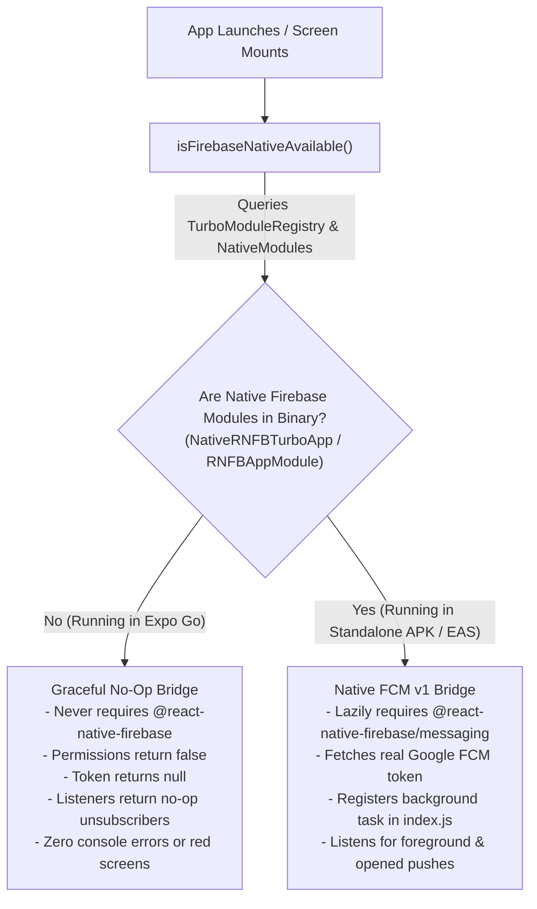

# Dual Runtime Architecture: Expo Go & Native FCM

This document details the architectural approach used in `customer-mobile` to enable **rapid UI development via standard Expo Go** while preserving **100% full-fidelity Firebase Cloud Messaging (FCM v1)** push notifications in standalone Android APK / EAS builds.

---

## 1. Problem Statement

### The Root Cause of `NativeRNFBTurboApp` Crashes
React Native Firebase (`@react-native-firebase/app` and `@react-native-firebase/messaging`) relies on custom native C++ TurboModules and Java/Kotlin code compiled into the Android application binary.

* **Expo Go** is a pre-compiled generic binary distributed via Google Play / App Store. It does not bundle `@react-native-firebase` native libraries.
* In standard ES6 modules, top-level static imports (e.g., `import { getMessaging } from '@react-native-firebase/messaging'`) are evaluated **at bundle initialization time** before any React component mounts.
* When Metro bundles the app and loads it inside Expo Go, the Firebase JavaScript initialization executes:
  ```javascript
  TurboModuleRegistry.getEnforcing('NativeRNFBTurboApp');
  ```
  Because the native module does not exist inside Expo Go's pre-compiled binary, it immediately triggers:
  ```text
  [runtime not ready]: Error: Native module NativeRNFBTurboApp is not registered.
  ```

---

## 2. Architectural Solution: Native Feature Detection & Lazy Dynamic Bridge

Rather than relying on hacky `try/catch` wrappers or brittle manifest properties (`Constants.appOwnership`), we implement **runtime feature detection directly against React Native's native module registry**.



---

## 3. Concrete Implementation

### A. Top-Level Entry Point (`index.js`)
The headless background message handler for Android is guarded so it only executes when native Firebase is present in the binary:

```javascript
import React from 'react';
import { Platform, TurboModuleRegistry, NativeModules } from 'react-native';
import { registerRootComponent } from 'expo';
import { ExpoRoot } from 'expo-router';

// Only initialize native FCM background handler if the native module is actually compiled in the binary
const isFirebaseAvailable =
  Platform.OS !== 'web' &&
  Boolean(
    TurboModuleRegistry.get?.('NativeRNFBTurboApp') ||
    TurboModuleRegistry.get?.('NativeRNFBTurboMessaging') ||
    NativeModules?.RNFBAppModule ||
    NativeModules?.NativeRNFBTurboApp
  );

if (isFirebaseAvailable) {
  try {
    const { getMessaging, setBackgroundMessageHandler } = require('@react-native-firebase/messaging');
    const messaging = getMessaging();
    setBackgroundMessageHandler(messaging, async (remoteMessage) => {
      console.log('[FCM Background] Headless message received:', remoteMessage);
    });
  } catch (e) {
    console.warn('[FCM Background] Native messaging init:', e?.message || e);
  }
}

export function App() {
  const ctx = require.context('./src/app');
  return React.createElement(ExpoRoot, { context: ctx });
}

registerRootComponent(App);
```

### B. Service Bridge (`src/v1/services/fcmService.ts`)
The service checks the native registry and memoizes the dynamic `require()` call:

```typescript
function isFirebaseNativeAvailable(): boolean {
  if (Platform.OS === 'web') return false;

  try {
    const hasTurboApp = Boolean(TurboModuleRegistry.get?.('NativeRNFBTurboApp'));
    const hasTurboMessaging = Boolean(TurboModuleRegistry.get?.('NativeRNFBTurboMessaging'));
    const hasLegacyApp = Boolean(
      (NativeModules as any)?.RNFBAppModule || (NativeModules as any)?.NativeRNFBTurboApp
    );

    return hasTurboApp || hasTurboMessaging || hasLegacyApp;
  } catch {
    return false;
  }
}

let cachedNativeMessaging: any = undefined;

function getNativeMessagingModule(): any | null {
  if (!isFirebaseNativeAvailable()) return null;

  if (cachedNativeMessaging !== undefined) {
    return cachedNativeMessaging;
  }

  try {
    cachedNativeMessaging = require('@react-native-firebase/messaging');
    return cachedNativeMessaging;
  } catch (err) {
    console.warn('[FCM] Native messaging module not found:', err);
    cachedNativeMessaging = null;
    return null;
  }
}
```

---

## 4. Runtime Behavior Matrix

| Capability | In Expo Go (Local Development) | In Standalone APK / EAS (Production / QA) |
| :--- | :--- | :--- |
| **UI & Layouts** | 100% Functional (Tailwind, Lucide, SVG) | 100% Functional |
| **Navigation & Screens** | 100% Functional (Expo Router, tabs, modals) | 100% Functional |
| **Backend REST APIs** | 100% Functional (Auth, Orders, Profile, Claims) | 100% Functional |
| **Session & Storage** | 100% Functional (Tokens, SecureStore) | 100% Functional |
| **FCM Native Push** | Gracefully disabled (returns `null` token, `false` perm) | **Active** (Native push token acquired and synced) |
| **Background Push Handler** | Skipped | **Active** (Headless task registered) |
| **Console Output** | Clean (Zero TurboModule errors) | Normal production telemetry |

---

## 5. Developer Workflows

### Scenario 1: Developing UI, Screens, and Business Flows
Run the local Metro dev server and open via standard **Expo Go**:
```bash
cd apps/customer-mobile
npx expo start
```
Scan the QR code with Expo Go on your mobile device. All screens, order tracking, auth flows, and QR features work seamlessly.

### Scenario 2: Testing Real FCM Push Notifications & Production Builds
To test receiving real background/foreground FCM push notifications on a physical device, build and install the standalone native APK:

* **Via GitHub Actions**:
  Trigger the on-demand workflow `.github/workflows/build-customer-apk.yml` via the GitHub Actions tab. Download and install `parcelhub-customer.apk`.
* **Via EAS Build**:
  ```bash
  eas build -p android --profile preview
  ```
* **Via Local Android Build**:
  ```bash
  npx expo run:android
  ```

---

## 6. Rule for Future Native Modules
If any future library requiring custom native code (e.g. Google Sign-In, Bluetooth, custom camera hardware) is added to `customer-mobile`, **do not use top-level static `import` statements**. Wrap the native module instantiation inside a similar `TurboModuleRegistry` check or lazy `require()` so that Expo Go UI testing remains functional.
